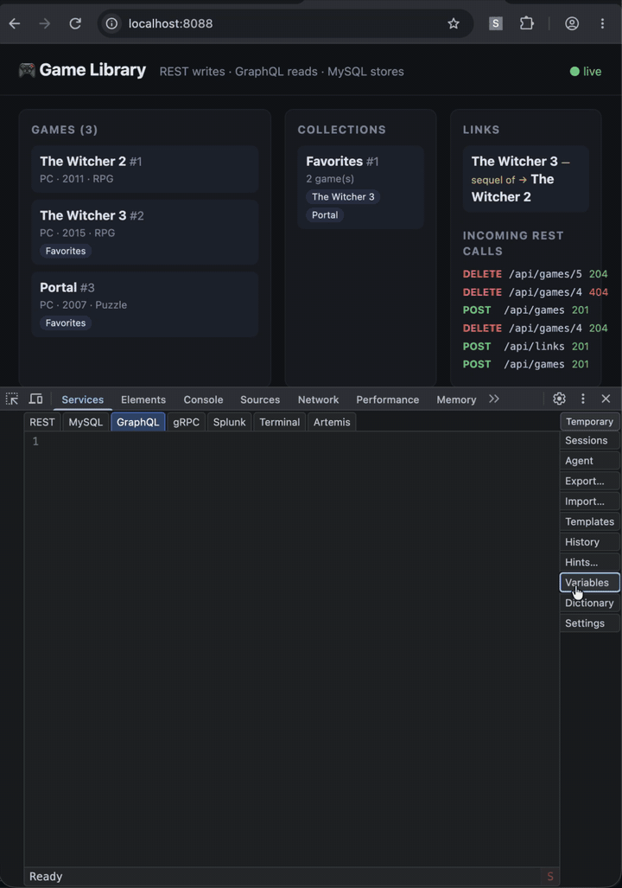

# Services DevTools

A Chrome DevTools panel for developers who work with backend services. Send
REST, GraphQL, gRPC and OpenSearch requests, run MySQL queries, search Splunk,
look into ActiveMQ Artemis queues and messages, and run terminal commands right
next to the page you are debugging, with shared variables, saved checks,
templates and request history in one place.
macOS 13.5+ on Apple Silicon.



## Install, update, uninstall

Install the latest release:

```sh
curl -fsSL https://github.com/duhon/devtool/releases/latest/download/install.sh | bash
```

Then follow the installer's instructions to add the extension to Chrome once.
The application opens in two ways: inside Chrome DevTools → **Services**, or
standalone in its own tab:

```text
chrome-extension://ckicpgdfkgcmgnclbfbcbkillcpaffnb/services.html
```

The installer installs the application only. Add the services you need in
**Settings** → **Modules**: the standard ones come from this repository's
releases.

Updates are installed from inside the application: **Settings** →
**Modules** lists the application (its first row) and every module with their
sources, versions and newer versions; **Update** installs one.

Uninstall, then remove the extension in Chrome (your data is kept):

```sh
"$HOME/Library/Application Support/ServicesDevTools/uninstall"
```

## Extensions

Every service and side panel is a module, and you can write your own. Modules
are installed from sources only: put the package file in `modules/` of a folder
source and install it in **Settings** → **Modules**. How to write, test and package a
service or a panel module with the SDK:
[examples/echo/README.md](examples/echo/README.md).

A team can share modules and settings through **Settings** → **Sources**: add a
GitHub repository or a local folder, then install its modules, sync its
Dictionary sets, templates and hints, and apply its Agent skills. A source is laid out as

```text
dictionary.json          {"sets": {"<set>": {"<VAR>": "value"}}}
templates.json           {"<module>": {"<section>": "<templates text>"}}
hints/<module>.md        a module's hints
skills/<name>/SKILL.md   Agent skills
modules/*.module.tgz     module packages, <id>-<version>.module.tgz
```

A GitHub source is a folder of a branch: **Repository**, optional **Branch**
(the default branch otherwise) and optional **Folder**. Checking it lists the
folder's files through GitHub's API and downloads a package only when that file
changed, so the folder may keep several versions: Settings → Modules offers the
newest of each module. Commit the package files where suits the team:

- **a folder in the main branch** (`devtools/` next to the code): nothing extra
  to set up, but every package version stays in the repository's history and
  makes clones bigger;
- **a separate branch** (an orphan `devtools` branch, say): the code's history
  stays small; force-push a single commit with only the current packages to keep
  the branch small too;
- **a separate repository**: its own access rights and history, apart from the
  code.

The Standard source is the `modules` branch of `duhon/devtool`, which CI
replaces with the newest package of each standard module.

Panels save your Dictionary, templates and hints into the **Local** source, the
first row of Settings → Sources. **Sync** on a source's row merges it with Local
file by file, both ways: a folder source gets the files written, a GitHub source
a commit. A file only the source has is copied into Local; a change made on both
sides opens in the **Diff** panel to resolve.

A skill gets the source's name as a prefix: `skills/wordpress/` of source
*Team* becomes `team-wordpress`. The Agent sees only each skill's name and
`description` and loads the skills that match the request, so the description
should say what the skill covers and when to use it, for example:

```text
---
name: wordpress
description: WordPress database - wp_ tables, table prefix, post and user meta, common MySQL queries. Use when the request mentions WordPress.
---
```

The Agent reads only `SKILL.md`, not other files beside it.

---

[Development](DEVELOPMENT.md) · [Installer details](installer/README.md)
